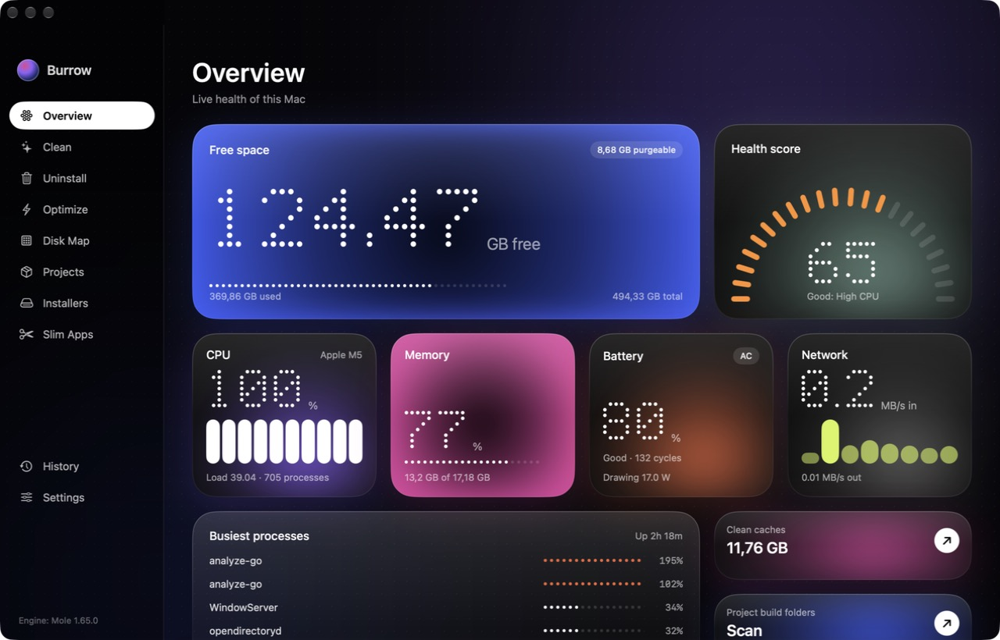
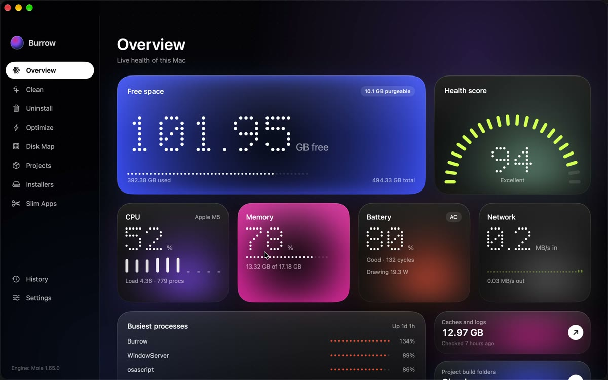

# Burrow

A free, open-source macOS app for [Mole](https://github.com/tw93/Mole), the deep cleaner by tw93.
Everything Mole does in the terminal, in one window: clean, uninstall, optimize, map the disk,
remove project build folders and old installers, slim universal apps, and watch system health.



**Demo (41 s):** every page and the moves between them.

[](docs/demo.mp4)

## Why

Mole is excellent but lives in the terminal, and its own app is paid. Burrow puts a native
SwiftUI window on top of the same engine. Clean, Uninstall, Optimize, Slim and removing all build
folders run through Mole, so its safety checks, protection rules and Trash-first deletes stay in
charge. The few things Burrow removes itself (installers, single build folders, Disk Map items you
pick) go to the Trash.

## What is inside

| Page | Mole command | What you get |
|---|---|---|
| Overview | `mo status --watch` | Live free space, health score, CPU, memory, battery, network, busiest processes |
| Clean | `mo clean` | Dry-run preview by category, then one-click clean (system caches optional, asks for your password natively) |
| Uninstall | `mo uninstall` | All apps with sizes, multi-select, preview leftovers, Trash or permanent; **Leftovers of removed apps**: caches, logs, web data and settings of apps that are already gone, grouped per app, to the Trash |
| Optimize | `mo optimize` | Pending maintenance steps and performance diagnosis |
| Disk Map | `mo analyze --json` | Treemap with drill-down, reveal in Finder, move to Trash |
| Projects | `mo purge` | Build folders grouped by project, remove all or a selection |
| Installers | (native, same folders as `mo installer`) | Old `.dmg`, `.pkg`, `.iso`, `.xip` files, move to Trash |
| Slim Apps | `mo slim` | Intel code in universal apps, pick which apps to slim |
| History | `mo history --json` | Every run and what it changed |
| Settings | config files, `mo touchid` | Protected paths, project scan folders, Touch ID for sudo, full removal |

Every scan is a Mole dry run that keeps going while you look at other pages; the sidebar marks
the pages still working, and the page shows what Mole has found so far. Results are kept between
launches: pages show the last result at once and never re-scan on their own. At launch, anything
missing or older than six hours is checked again in the background, one scan at a time; ⌘R
re-scans whenever you want.

### Keyboard

| Keys | Does |
|---|---|
| ⌘1 … ⌘9, ⌘, | Go to a page |
| ⌘R | Scan again (or stop the running scan) |
| ⌘F | Search apps (Uninstall) |
| Esc | Clear the selection |
| Return | Answer the highlighted choice in a Mole prompt |

`Burrow -startPage clean` opens a page directly, which helps when taking screenshots.

## Install

Download `Burrow.dmg` from [Releases](../../releases), open it and drag Burrow to Applications.
The app is ad-hoc signed (not notarized), so macOS blocks the first launch: open
**System Settings → Privacy & Security** and press **Open Anyway** next to Burrow, or run:

```bash
xattr -dr com.apple.quarantine /Applications/Burrow.app
```

Requires macOS 26 or later on Apple silicon.

## Nothing left behind

Mole ships inside the app (`Contents/Resources/mole`); nothing is installed into your system.
Mole keeps its settings and logs in `~/.config/mole`, `~/.cache/mole` and `~/Library/Logs/mole`.
**Settings → Remove Burrow completely** moves those, the app's preferences and the app to the
Trash. If Mole is also installed on its own (`mo` on your PATH), Mole's files stay.

## Build

Only the Xcode Command Line Tools are needed (no Xcode):

```bash
swift test
scripts/bundle.sh     # → build/Burrow.app
scripts/dmg.sh        # → build/Burrow.dmg
BURROW_SLOW_TESTS=1 swift test --filter uninstallPreview   # drives a real Mole dry run in a terminal
```

The Mole engine is vendored in `Vendor/mole` (version in `Vendor/mole/VERSION`). To update it,
replace that folder with a newer Mole release's `libexec` contents.

## License

GPL-3.0, the same as Mole. Mole © tw93 and contributors; source at
[github.com/tw93/Mole](https://github.com/tw93/Mole) (the bundled `analyze-go` and `status-go`
binaries are built from that source, tag `V1.65.0`).
