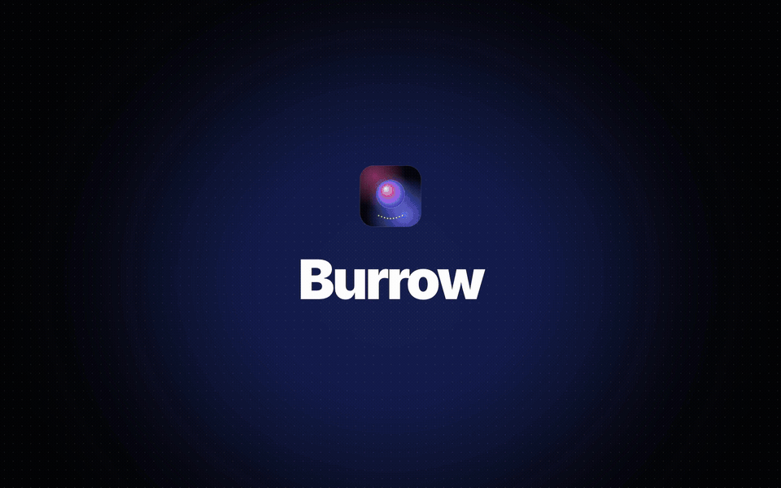

<div align="center">


# Burrow

**The free, open-source Mac cleaner.** A native SwiftUI app for [Mole](https://github.com/tw93/Mole):
clean caches, uninstall apps with their leftovers, map your disk and watch your Mac's health.

[](../../releases/latest)
[](../../releases)
[](LICENSE)
[](#install)
[](../../stargazers)

**[⬇ Download Burrow.dmg](../../releases/latest/download/Burrow.dmg)** · [Full 41 s tour](../../releases/download/v0.3.0/demo.mp4) · [What's new](../../releases/latest)



</div>

## Burrow and the alternatives

| | **Burrow** | Mole for Mac | CleanMyMac |
|---|---|---|---|
| Price | **Free** | $19 | Paid subscription |
| Source code | **Open, GPL-3.0** | Not public | Closed |
| Cleaning engine | Mole CLI, bundled and unchanged | Mole | Its own |
| Deletes through | Mole's safety checks, or the Trash | Mole | Its own rules |

No account, no ads, no telemetry. Burrow is a community project, not affiliated with Mole or tw93. Mole's own native app is
[Mole for Mac](https://mole.fit/); if Burrow is useful to you, consider supporting Mole's author too.

## Why

Mole is excellent but lives in the terminal, and its own app is paid. Burrow puts a native
SwiftUI window on top of the same engine. Clean, Uninstall, Optimize, Slim and removing all build
folders run through Mole, so its safety checks, protection rules and Trash-first deletes stay in
charge. The few things Burrow removes itself (installers, single build folders, Disk Map items you
pick) go to the Trash.

## What is inside

| Page | Mole command | What you get |
|---|---|---|
| Overview | `mo status --watch` | Live free space, health score, CPU, memory, battery, network, busiest processes |
| Clean | `mo clean` | Dry-run preview by category, then one-click clean (system caches optional, asks for your password natively) |
| Uninstall | `mo uninstall` | All apps with sizes, multi-select, preview leftovers, Trash or permanent; **Leftovers of removed apps**: caches, logs, web data and settings of apps that are already gone, grouped per app, to the Trash. Delete an app anywhere (Finder, the Dock) and a panel at the top of the screen offers its leftovers at once |
| Optimize | `mo optimize` | Pending maintenance steps and performance diagnosis |
| Disk Map | `mo analyze --json` | Treemap with drill-down, reveal in Finder, move to Trash |
| Projects | `mo purge` | Build folders grouped by project, remove all or a selection |
| Installers | (native, same folders as `mo installer`) | Old `.dmg`, `.pkg`, `.iso`, `.xip` files, move to Trash |
| Slim Apps | `mo slim` | Intel code in universal apps, pick which apps to slim |
| History | `mo history --json` | Every run and what it changed |
| Settings | config files, `mo touchid` | Protected paths, project scan folders, Touch ID for sudo, offers after an app is deleted, open at login |

Every scan is a Mole dry run that keeps going while you look at other pages; the sidebar marks
the pages still working, and the page shows what Mole has found so far. Results are kept between
launches: pages show the last result at once and never re-scan on their own. At launch, anything
missing or older than six hours is checked again in the background, one scan at a time; ⌘R
re-scans whenever you want.

A real run (Clean, Slim, Uninstall, Optimize) shows live progress instead of a terminal: the space
freed so far, what Mole is doing now and each step as it finishes, with Mole's own log one click
away. Mole's questions (your password, its final confirmation) become native buttons.

### Keyboard

| Keys | Does |
|---|---|
| ⌘1 … ⌘9, ⌘, | Go to a page |
| ⌘R | Scan again (or stop the running scan) |
| ⌘F | Search apps (Uninstall) |
| Esc | Clear the selection |
| Return | Answer the highlighted choice in a Mole prompt |

`Burrow -startPage clean` opens a page directly, which helps when taking screenshots.

## Install

Burrow is ad-hoc signed (not notarized), so macOS stops it twice: once when you open the DMG
("Burrow.dmg Not Opened") and once on the app's first launch. Each time press **Done**, then open
**System Settings → Privacy & Security** and press **Open Anyway**. Or skip both dialogs from Terminal:

1. Download `Burrow.dmg` from [Releases](../../releases) and unblock it:
   ```bash
   xattr -d com.apple.quarantine ~/Downloads/Burrow.dmg
   ```
2. Open it and drag Burrow to Applications, then unblock the app:
   ```bash
   xattr -dr com.apple.quarantine /Applications/Burrow.app
   ```

Updates after that install without these steps.

Requires macOS 26 or later on Apple silicon.

Burrow updates itself: it checks the GitHub releases once a day ([Sparkle](https://sparkle-project.org),
EdDSA-signed) and installs a new version when you quit. **Burrow → Check for Updates…** looks
right away. Versions before 0.4.0 need one manual download.

## Nothing left behind

Mole ships inside the app (`Contents/Resources/mole`); nothing is installed into your system.
Mole keeps its settings and logs in `~/.config/mole`, `~/.cache/mole` and `~/Library/Logs/mole`.
To uninstall, drag Burrow to the Trash like any Mac app. What is left (its preferences and
cached scans, Mole's folders above) is what any cleaner's leftover scan, Mole's included, finds.

## Build

Only the Xcode Command Line Tools are needed (no Xcode):

```bash
swift test
scripts/bundle.sh     # → build/Burrow.app
scripts/dmg.sh        # → build/Burrow.dmg
BURROW_SLOW_TESTS=1 swift test --filter uninstallPreview   # drives a real Mole dry run in a terminal
```

The Mole engine is vendored in `Vendor/mole` (version in `Vendor/mole/VERSION`). To update it,
replace that folder with a newer Mole release's `libexec` contents.

## License

GPL-3.0, the same as Mole. Mole © tw93 and contributors; source at
[github.com/tw93/Mole](https://github.com/tw93/Mole) (the bundled `analyze-go` and `status-go`
binaries are built from that source, tag `V1.65.0`).
